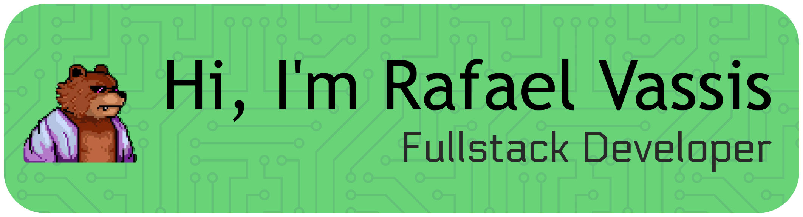



  

<h1 align="center">Olá! Eu sou o Rafael 👋</h1>

  Estudante de <b>Sistemas de Informação</b> na <b>PUC Minas</b> 
  <i>Transformando estudo em projetos e projetos em experiência.</i>

  

---

## ⭐ Projetos full stack

### [📋 Gerenciador de Tarefas](https://github.com/rafaelvassis/GerenciadorTarefas) &nbsp;·&nbsp; [🔗 Ver online](https://gerenciador-tarefas-rafaelvassis-eabdewc9e3f5cved.brazilsouth-01.azurewebsites.net)

Aplicação **full stack** para organizar tarefas, com categorias, participantes e filtros, publicada na nuvem com deploy automatizado.

- CRUD completo com modelo relacional (1:N e N:N) e regras garantidas também no banco
- Arquitetura **MVC**, migrations automáticas e dados iniciais na primeira execução
- Deploy contínuo com **GitHub Actions** no **Azure App Service** e **Azure SQL**

### [🎮 Catálogo de Jogos](https://github.com/rafaelvassis/Catalogo-de-Jogos) &nbsp;·&nbsp; [🔗 Ver online](https://game-catalog-lovat.vercel.app)

Aplicação **full stack** para cadastrar, listar, editar e excluir jogos, com API REST em .NET e frontend React instalável como **PWA**.

- API em **ASP.NET Core (Minimal API)** com endpoints REST e CORS configurável, empacotada em **Docker**
- Frontend **mobile first** em **React 19 + Vite**, com validação por campo e tratamento de falhas da API
- Deploy do backend e do frontend na **Vercel**

---

## 🚀 Stack

---

## 📂 Outros projetos

| Projeto | O que faz | Stack | Demo |
|---------|-----------|-------|:----:|
| [⏱️ TaskCycle](https://github.com/rafaelvassis/taskcycle-app) | Gestão de tempo com ciclos de foco e descanso | React, TypeScript, Web Workers | [🔗](https://taskcycle-app.vercel.app/) |
| [💱 Conversor de Moedas](https://github.com/rafaelvassis/conversor-moedas) | Conversão de moedas em tempo real | React, TypeScript, API REST | [🔗](https://conversor-de-moedas-blond.vercel.app) |
| [🌤️ Clima Agora](https://github.com/rafaelvassis/clima-agora) | Previsão do tempo por cidade | React, TypeScript, API REST | |
| [📮 Busca CEP](https://github.com/rafaelvassis/busca-cep) | Consulta de endereços via API ViaCEP | HTML, CSS, JavaScript | [🔗](https://busca-cep-woad-sigma.vercel.app) |
| [📝 Quick Notes](https://github.com/rafaelvassis/quick-notes) | Notas com persistência em LocalStorage | HTML, CSS, JavaScript | [🔗](https://quick-notes-chi-one.vercel.app) |
| [🧮 Calculadora](https://github.com/rafaelvassis/calculadora-React) | Calculadora inspirada na do Windows | React, TypeScript | [🔗](https://calculadora-react-alpha.vercel.app) |
| [🔐 Gerador de Senhas](https://github.com/rafaelvassis/Gerador-de-Senhas-JS) | Senhas personalizáveis | HTML, CSS, JavaScript | [🔗](https://gerador-de-senhas-js.vercel.app) |
| [👥 User Management](https://github.com/rafaelvassis/user-management-system-csharp) | CRUD de usuários no console | C#, POO, JSON | |
| [🐍 Snake Game](https://github.com/rafaelvassis/snake-game-csharp-console) | Clássico jogo Snake no console | C#, POO | |

---

  <i>Aberto a oportunidades de estágio e desenvolvimento. Vamos conversar! 🤝</i>

